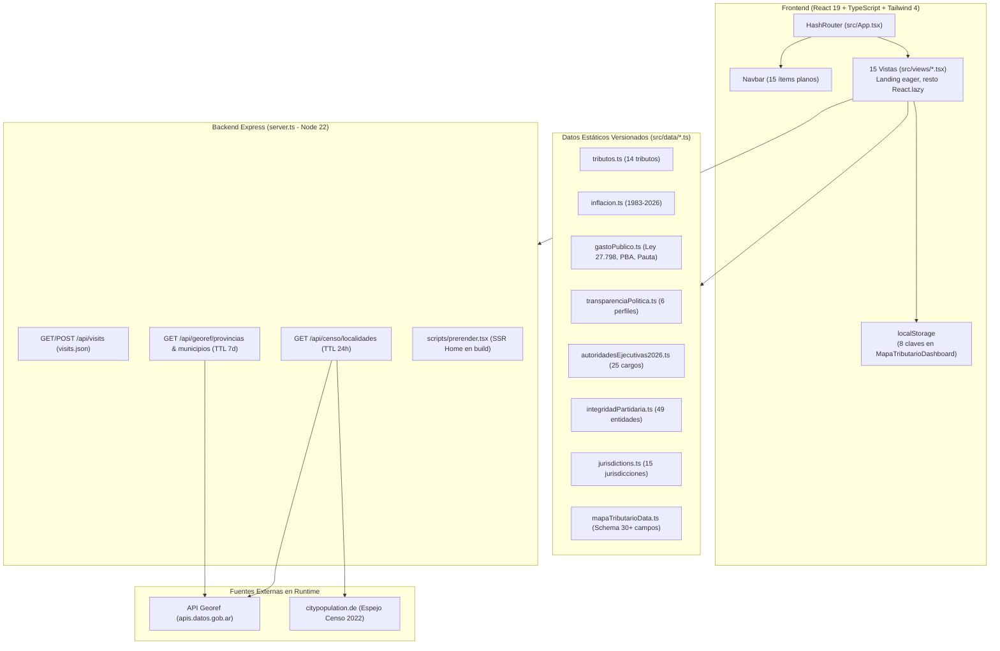
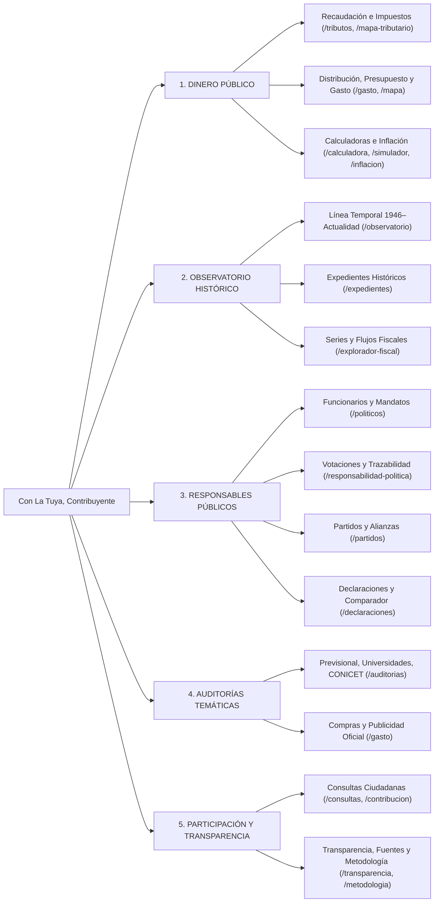

# ARCHITECTURE.md
## Con La Tuya, Contribuyente — Arquitectura Actual y Arquitectura Objetivo (Observatorio 1946–Actualidad)

---

## 1. Arquitectura Actual Confirmada

### 1.1 Diagrama de Capas Actuales

### 1.2 Dualidad de Esquemas de Tipos Actuales
Actualmente coexisten **dos sistemas de tipos separados** que generan duplicación de entidades:
1. [`src/types.ts`](file:///G:/Mi%20unidad/Proyectos/Con%20la%20tuya/src/types.ts): Define `EvidenceLevel` (`A | B | C | D`), `VerifiedData<T>`, `Jurisdiction`, `Tributo`, `Politician`, `ProductSustance`, `ContributionProposal`.
2. [`src/types/mapaTributario.ts`](file:///G:/Mi%20unidad/Proyectos/Con%20la%20tuya/src/types/mapaTributario.ts): Define un modelo paralelo más rico (`JurisdictionSchema`, `TributeTaxSchema`, `TributeHistoricalEventSchema`, `PoliticalActorSchema`, `VoteRecordSchema`, `SourceReferenceSchema`, `VerificationLogSchema`) con `VerificationStatusType` de 9 estados.
3. Interfaces locales en archivos de datos: `PoliticalTransparencyRecord` en [`src/data/transparenciaPolitica.ts`](file:///G:/Mi%20unidad/Proyectos/Con%20la%20tuya/src/data/transparenciaPolitica.ts), `SpendingJurisdiction` en [`src/data/gastoPublico.ts`](file:///G:/Mi%20unidad/Proyectos/Con%20la%20tuya/src/data/gastoPublico.ts), `StateTransparencyProfile` en [`src/data/transparenciaEstado.ts`](file:///G:/Mi%20unidad/Proyectos/Con%20la%20tuya/src/data/transparenciaEstado.ts).

---

## 2. Arquitectura Objetivo — Observatorio Histórico (1946–Actualidad)

### 2.1 Las Cinco Dimensiones Conectadas y Navegación Unificada

La navegación de 15 ítems planos se reorganiza en **5 secciones principales** (manteniendo todas las rutas existentes operativas y retrocompatibles):

### 2.2 Modelo Canónico de Evidencia y Entidades Históricas (`src/types/observatorio.ts`)

Para cubrir el horizonte **1946–actualidad** sin perder rigor metodológico ni mezclar etapas presupuestarias o monedas históricas (m$n, $ley, $a, Austral, ARS, USD), se introduce una capa canónica de tipos que extiende y conecta los modelos actuales:

1. **Estado Epistémico (`EpistemicStatus`):**
   - `'verificado'` (Hecho documentado en fuente primaria oficial)
   - `'oficial_con_reserva'` (Dato oficial con advertencia metodológica o intervención institucional documentada)
   - `'estimacion'` (Cálculo derivado con metodología explícita)
   - `'interpretacion'` (Análisis secundario claramente atribuido)
   - `'controversia'` (Disputa documental o judicial abierta con todas las partes citadas)
   - `'desconocido'` (Dato no publicado o pendiente de verificación; nunca completado con ficción)

2. **Fuente Documental (`CanonicalSourceRecord`):**
   - `id`, `title`, `issuer` (organismo emisor), `sourceType` (`'primaria_oficial' | 'secundaria_periodistica' | 'academica' | 'repositorio_cientifico'`), `url`, `archiveUrl`, `publicationDate`, `retrievedAt`, `validityPeriod`, `relevantExcerpt`, `sha256`, `verificationStatus`, `extractionMethod`, `correctionHistory[]`.

3. **Monto Monetario Normalizado (`HistoricalMonetaryAmount`):**
   - `nominalAmount`: número exacto según documento original.
   - `currency`: `'MSN' | 'PESO_LEY' | 'PESO_ARGENTINO' | 'AUSTRAL' | 'ARS' | 'USD'`.
   - `period`: año/mes de referencia.
   - `budgetStage`: `'recaudado' | 'credito_inicial' | 'credito_vigente' | 'comprometido' | 'devengado' | 'pagado' | 'estimado_no_presupuestario'`.
   - `realAdjustedAmount?` + `adjustmentIndex?` (ej. IPC INDEC base explícita).
   - `isIntergovernmentalTransfer`: booleano para **evitar doble conteo** al consolidar Nación + Provincias + Municipios.

4. **Trazabilidad de Intervención Pública (`PublicInterventionRole`):**
   - Separa estrictamente: `'autor_proyecto' | 'coautor' | 'voto_afirmativo' | 'voto_negativo' | 'abstencion' | 'ausente' | 'promulgacion' | 'firmante_decreto_resolucion' | 'autoridad_adjudicante' | 'responsable_ejecucion' | 'organismo_pagador'`.
   - Nunca atribuye una decisión a un funcionario solo por coincidencia temporal de mandato sin documento que acredite su intervención.

5. **Archivo y Comparador de Declaraciones (`PublicStatementRecord` & `StatementComparisonDossier`):**
   - Cada declaración conserva `officialId`, `roleAtStatement`, `date`, `topic`, `exactQuote`, `contextNote`, `mediaUrl`, `timestampRange`, `sourceId`.
   - El comparador relaciona 2+ declaraciones o una declaración con un acto/voto documentado, incluyendo `contextualExplanation` y prohibiendo calificaciones morales o veredictos automáticos.

6. **Expedientes Históricos y Auditorías Sectoriales (`HistoricalDossier` & `ThematicAuditRecord`):**
   - Conecta normativa, línea de tiempo, responsables con rol específico, montos con etapa presupuestaria, resultados medidos, limitaciones de medición y fuentes primarias (ej. Reforma Previsional 2008 Ley 26.425, YPF 1992/2012, Moratorias Previsionales, CONICET, Universidades Públicas, Compras Públicas).

---

## 3. Estrategia de Enrutamiento y SEO

1. **Fase Inmediata (Rama de trabajo):**
   - Mantener compatibilidad total con enlaces `HashRouter` (`/#/mapa`, `/#/tributos`, etc.) y añadir soporte híbrido de redirección y sincronización para no romper marcadores existentes.
   - Agrupar la navegación en los **5 pilares** dentro de [`Navbar.tsx`](file:///G:/Mi%20unidad/Proyectos/Con%20la%20tuya/src/components/Navbar.tsx) con menús desplegables accesibles por teclado (`aria-expanded`, `aria-current="page"`) y buscador global integrado.
2. **Endurecimiento del Servidor (`server.ts`):**
   - Configurar cabeceras de seguridad HTTP (`X-Content-Type-Options`, `X-Frame-Options`, `Referrer-Policy`), control de CORS configurable por entorno y limitador de tasa (rate limiting) por IP en memoria para `/api/visits/increment` y `/api/censo/localidades` sin depender de paquetes externos pesados.
   - Hacer configurable el puerto mediante `process.env.PORT || 3000`.
