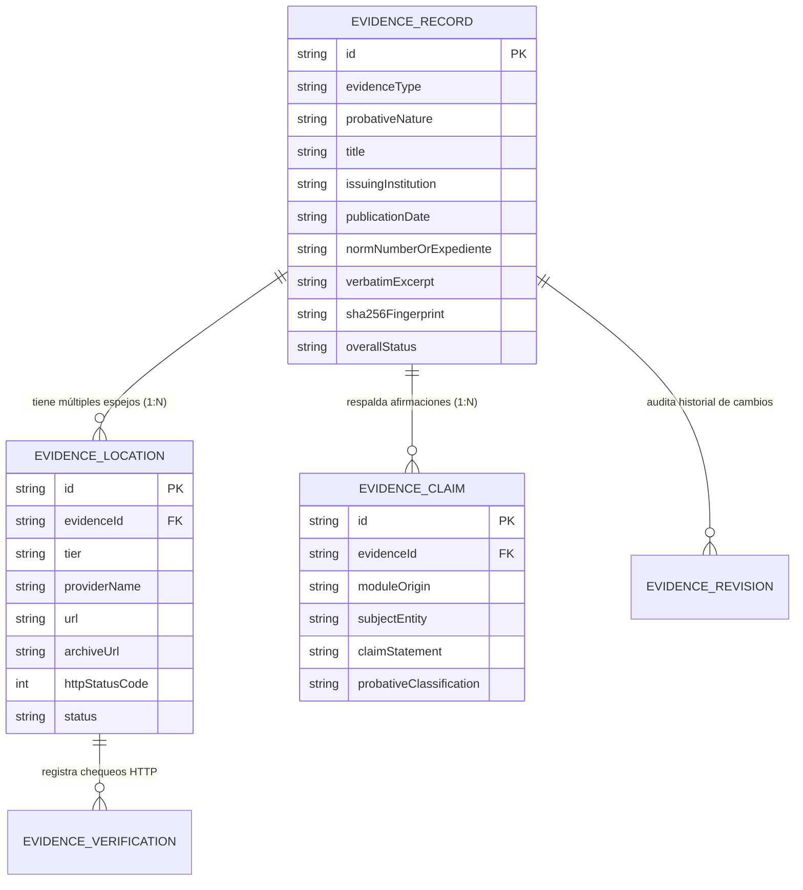

# EVIDENCE_ARCHITECTURE.md
## Arquitectura de Evidencia Independiente de URL

**Implementación en código:**
- Tipos e interfaces: [`src/types/evidencia.ts`](file:///G:/Mi%20unidad/Proyectos/Con%20la%20tuya/src/types/evidencia.ts)
- Repositorio y espejos: [`src/data/repositorioEvidencia.ts`](file:///G:/Mi%20unidad/Proyectos/Con%20la%20tuya/src/data/repositorioEvidencia.ts)
- Endpoints de API: [`server.ts`](file:///G:/Mi%20unidad/Proyectos/Con%20la%20tuya/server.ts) (`/api/evidencia/registro` y `/api/evidencia/monitoreo`)

---

## 1. Principio Rector

> **Una URL es una ubicación física temporal; NO es la evidencia en sí misma.**

En los portales públicos argentinos (`.gob.ar`, boletines municipales, portales legislativos) es frecuente que las rutas profundas cambien tras cambios de gestión o migraciones de CMS. Para evitar que la caída de un enlace invalide una prueba documental:

1. Ninguna afirmación crítica (`EvidenceClaim`) depende de una única cadena URL suelta.
2. Toda afirmación referencia un identificador persistente inmutable (`EvidenceRecord.id`, p. ej. `EVD-2008-ACTA-RES125-LEY-26425-AFJP`).
3. Cada `EvidenceRecord` conserva internamente los metadatos normativos completos, el extracto literal (`verbatimExcerpt`) y la huella criptográfica `SHA-256` (`sha256Fingerprint`).
4. Cada `EvidenceRecord` se asocia en relación `1:N` con múltiples ubicaciones verificables (`EvidenceLocation`) ordenadas por nivel de prioridad (`PRIMARY_OFFICIAL`, `SECONDARY_MIRROR`, `INSTITUTIONAL_REPOSITORY`, `WAYBACK_ARCHIVE`).

---

## 2. Diagrama de Entidades

---

## 3. Taxonomía de Naturaleza Probatoria (`ProbativeNatureType`)

La arquitectura impide mezclar tipos de prueba de distinta jerarquía epistemológica:

| Código | Etiqueta en UI | Qué acredita legal y metodológicamente |
|---|---|---|
| `acta_parlamentaria` | `ACTA PARLAMENTARIA` | Sentido exacto del voto nominal, abstención o ausencia en HCDN / HSN. |
| `ley_decreto_norma` | `NORMA OFICIAL (BORA)` | Sanción o promulgación de una ley, decreto o resolución. No equivale por sí sola a su ejecución física. |
| `registro_presupuestario` | `EJECUCIÓN CONTABLE` | Crédito vigente, devengado, pagado o serie estadística oficial (MECON, OPC, INDEC, BCRA). |
| `fallo_judicial_auditoria` | `FALLO / AUDITORÍA` | Sentencias judiciales o informes técnicos de control externo (AGN, SIGEN, CSJN). |
| `declaracion_audiovisual` | `DECLARACIÓN PÚBLICA` | Expresión verbal o escrita de un funcionario en una fecha dada. No constituye acto administrativo. |
| `portada_periodistica` | `PORTADA DE PRENSA` | Cómo fue titulado y presentado un hecho en la prensa de época. No reemplaza al Boletín Oficial. |
| `encuesta_metodologica` | `ESTUDIO / ENCUESTA` | Medición demoscópica o académica de clima social con ficha técnica explícita. |
| `manifestacion_publica` | `REPERCUSIÓN SOCIAL` | Paros generales, movilizaciones o protestas documentadas en crónicas institucionales. |
